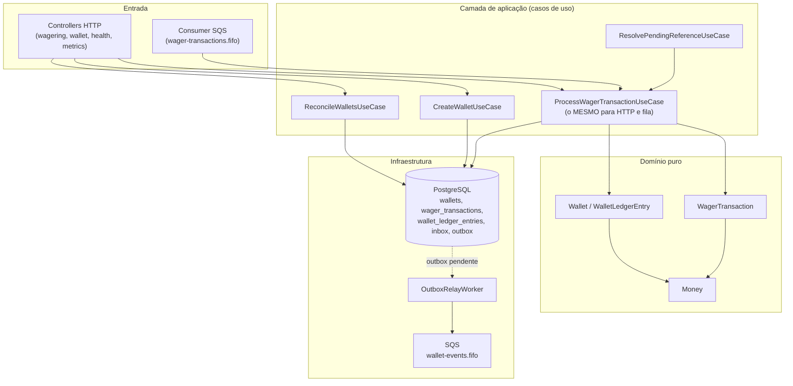

# Fluxos do sistema (diagramas)

Esta pasta documenta, com diagramas [Mermaid](https://mermaid.js.org/), os principais fluxos do
**Distributed Wagering Processor**. Cada arquivo é autocontido: contexto curto, diagrama(s) e os
arquivos de código que implementam o fluxo, pra navegar direto da documentação pro código.

Para a visão de decisões arquiteturais (trade-offs, ADRs), ver [`../ARCHITECTURE.md`](../ARCHITECTURE.md).
Para setup, comandos e contrato HTTP, ver [`../README.md`](../README.md).

## Índice

| Fluxo | Quando acontece |
|---|---|
| [Criação de wallet](./criacao-de-wallet.md) | `POST /wallets` |
| [Processamento de uma transação](./processamento-de-transacao.md) | `POST /wagering/transactions` e consumo da fila SQS — o **fluxo central** do sistema |
| [Regras de liquidação por tipo de operação](./regras-de-liquidacao.md) | Dentro do processamento: BET/WIN/LOSS/REFUND/ROLLBACK, resolução de referência |
| [Concorrência: duas instâncias disputando a mesma wallet](./concorrencia.md) | Cenário obrigatório do enunciado (100.00 → duas apostas de 80.00) |
| [Mensageria SQS: consumo, retry e DLQ](./mensageria-sqs.md) | Consumidor da fila `wager-transactions.fifo` |
| [Outbox transacional e o relay](./outbox-transacional.md) | Publicação de eventos de integração, depois do commit |
| [Referências fora de ordem](./referencias-fora-de-ordem.md) | `REFUND`/`ROLLBACK` que chegam antes da transação referenciada |
| [Reconciliação](./reconciliacao.md) | `POST /wallets/:id/reconciliation` |
| [Autenticação (Port/Adapter, hoje no-op)](./autenticacao.md) | Toda requisição HTTP, quando um controller usar o Guard |
| [Observabilidade: health checks e métricas](./observabilidade.md) | `GET /health/live`, `GET /health/ready`, `GET /metrics` |

## Mapa dos módulos

