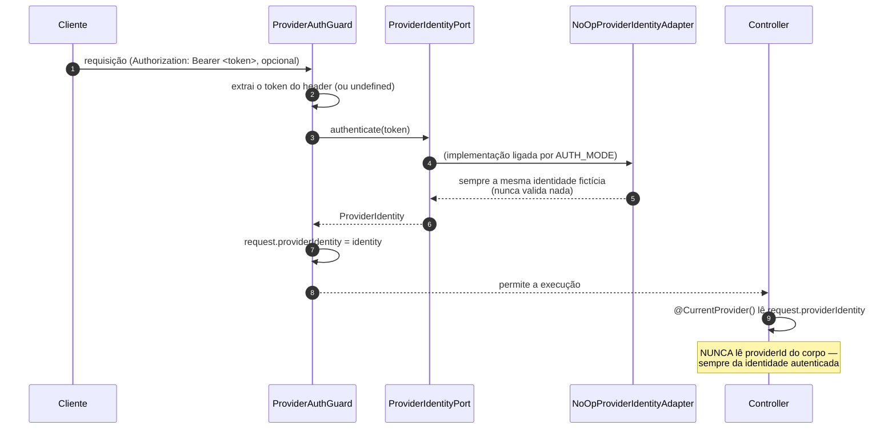
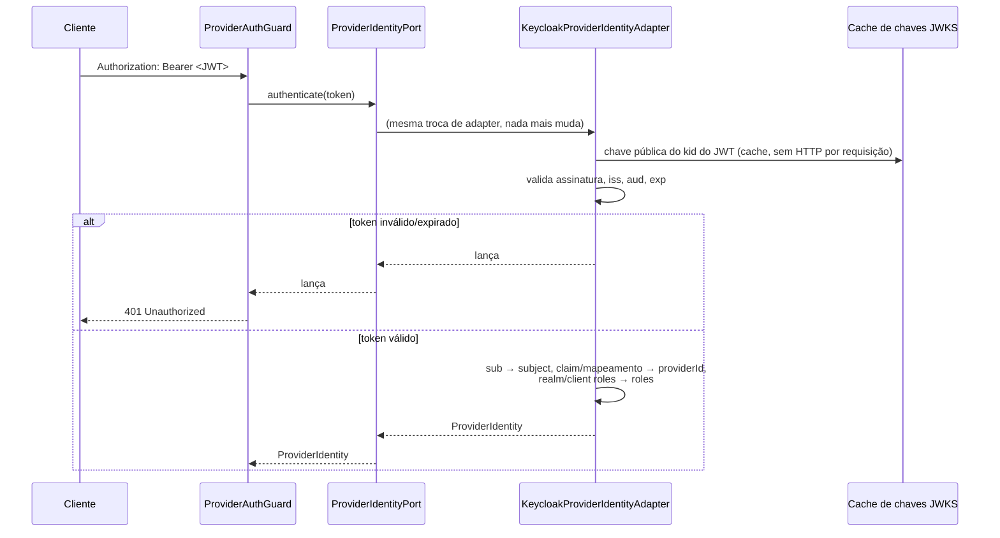
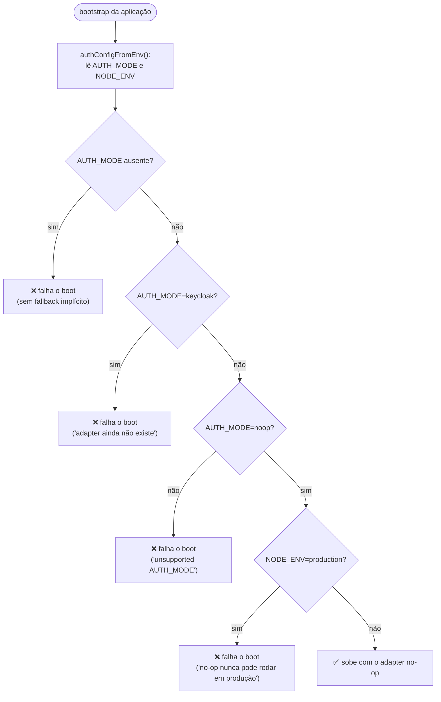

# Autenticação (Port/Adapter, hoje no-op)

A integração real com Keycloak **não está implementada** (decisão de escopo do enunciado — ver
ADR-008 no `ARCHITECTURE.md`). O que existe é a estrutura completa, pronta pra trocar o adapter
sem tocar em Guard, decorator ou controller: `src/platform/auth/`.

## Fluxo (hoje, com o adapter no-op)

## Fluxo futuro (Keycloak — desenhado, não implementado)

## Por que isso é seguro como está

## O que NÃO foi feito (de propósito)

- Nenhum controller existente (`wagering`, `wallet`) usa `@UseGuards(ProviderAuthGuard)` — ligar
  o Guard numa rota é decisão de produto (quais rotas exigem identidade) e muda o contrato
  público (o `providerId` do corpo deixaria de valer), fora do escopo desta etapa.
- `/health/*` e `/metrics` continuam sempre abertos, como o enunciado exige.
- Nenhuma biblioteca de Keycloak foi instalada; nenhuma chamada de rede acontece.

## Arquivos

- `src/platform/auth/provider-identity.port.ts` — contrato, zero dependência de framework.
- `src/platform/auth/no-op-provider-identity.adapter.ts`
- `src/platform/auth/auth.config.ts` — validação fail-fast de `AUTH_MODE`/`NODE_ENV`.
- `src/platform/auth/provider-auth.guard.ts`, `current-provider.decorator.ts`, `auth.module.ts`.
- `ARCHITECTURE.md` (ADR-008) — desenho completo da integração futura.
- `test/unit/platform/auth/` — cobertura de cada peça.
