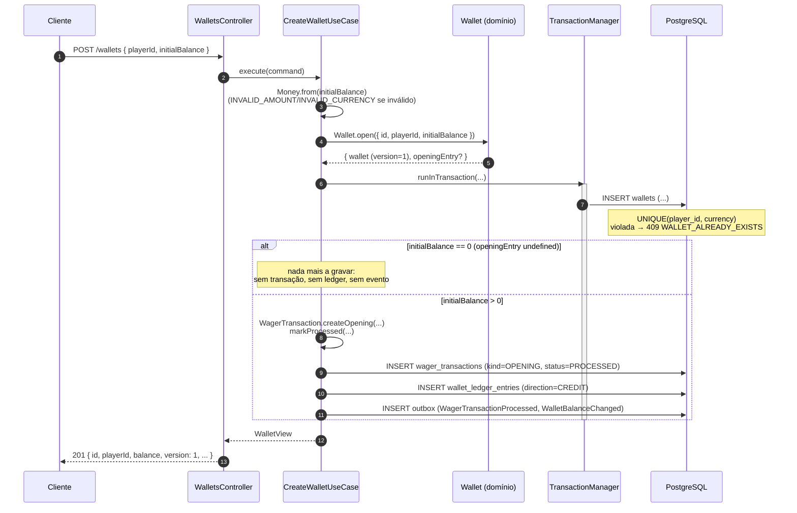

# Criação de wallet

`POST /wallets` — `src/modules/wallet/presentation/controllers/wallets.controller.ts` →
`src/modules/wallet/application/use-cases/create-wallet.use-case.ts`

Quando o saldo inicial é maior que zero, a abertura gera uma transação interna `OPENING`
(a única forma de `OPENING` existir — nunca é submetida pela API nem pela fila) com um
lançamento `CREDIT` correspondente, e os dois eventos de integração — tudo na **mesma
transação SQL** que insere a wallet.

## Pontos importantes

- **`providerId` da transação OPENING é `"system"`**, reservado — nenhum provedor real pode
  usá-lo (`RESERVED_PROVIDER` se tentar).
- **Saldo zero não cria rastro nenhum**: sem `wager_transactions`, sem `wallet_ledger_entries`,
  sem evento — só a linha em `wallets`, com `version = 1`.
- A publicação de verdade na fila (`wallet-events.fifo`) **não acontece aqui**: os eventos só
  viram linhas na tabela `outbox`; quem publica é o relay (ver
  [outbox-transacional.md](./outbox-transacional.md)).
- Conflito de wallet duplicada (mesmo `playerId` + `currency`) é pego pela constraint
  `uq_wallets_player_currency` do banco, não só por uma checagem em memória — por isso é seguro
  mesmo com duas instâncias criando a mesma wallet ao mesmo tempo.
