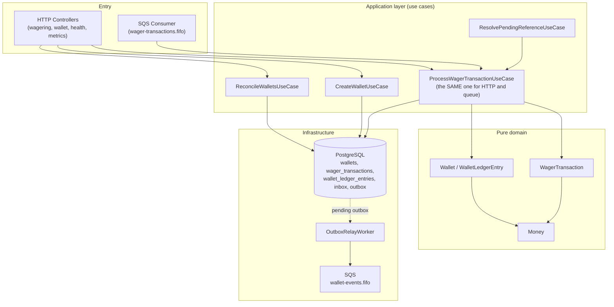

# System flows (diagrams)

This folder documents, with [Mermaid](https://mermaid.js.org/) diagrams, the main flows of the
**Distributed Wagering Processor**. Each file is self-contained: short context, diagram(s), and
the code files that implement the flow, so you can navigate straight from the documentation to
the code.

For the view of architectural decisions (trade-offs, ADRs), see [`../../ARCHITECTURE.en.md`](../../ARCHITECTURE.en.md).
For setup, commands, and the HTTP contract, see [`../../README.en.md`](../../README.en.md).

## Index

| Flow | When it happens |
|---|---|
| [Wallet creation](./wallet-creation.md) | `POST /wallets` |
| [Processing a transaction](./transaction-processing.md) | `POST /wagering/transactions` and SQS queue consumption — the system's **central flow** |
| [Settlement rules by operation type](./settlement-rules.md) | Within processing: BET/WIN/LOSS/REFUND/ROLLBACK, reference resolution |
| [Concurrency: two instances disputing the same wallet](./concurrency.md) | Mandatory scenario from the spec (100.00 → two bets of 80.00) |
| [SQS messaging: consumption, retry, and DLQ](./sqs-messaging.md) | Consumer of the `wager-transactions.fifo` queue |
| [Transactional outbox and the relay](./transactional-outbox.md) | Publication of integration events, after commit |
| [Out-of-order references](./out-of-order-references.md) | `REFUND`/`ROLLBACK` that arrive before the referenced transaction |
| [Reconciliation](./reconciliation.md) | `POST /wallets/:id/reconciliation` |
| [Authentication (Port/Adapter, currently no-op)](./authentication.md) | Every HTTP request, when a controller uses the Guard |
| [Observability: health checks and metrics](./observability.md) | `GET /health/live`, `GET /health/ready`, `GET /metrics` |

## Module map

