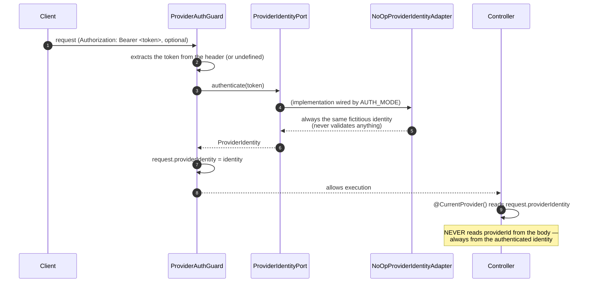
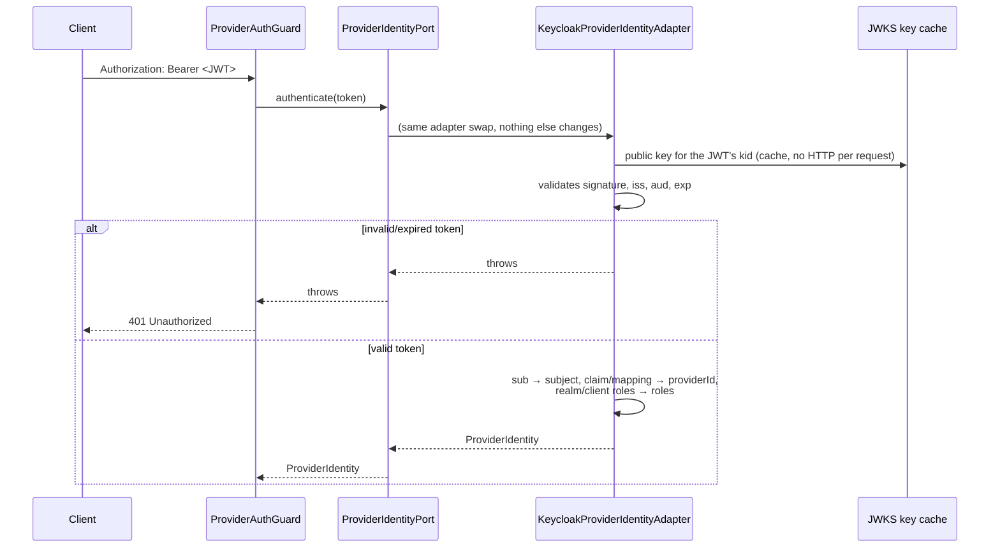
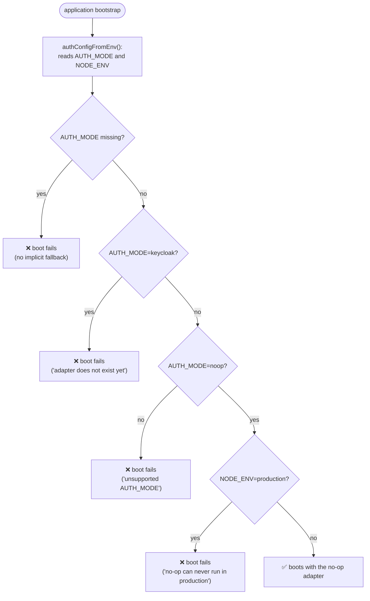

# Authentication (Port/Adapter, currently no-op)

The real Keycloak integration **is not implemented** (scope decision from the spec — see
ADR-008 in `ARCHITECTURE.en.md`). What exists is the complete structure, ready to swap the adapter
without touching the Guard, decorator, or controller: `src/platform/auth/`.

## Flow (today, with the no-op adapter)

## Future flow (Keycloak — designed, not implemented)

## Why this is safe as it stands

## What was NOT done (on purpose)

- No existing controller (`wagering`, `wallet`) uses `@UseGuards(ProviderAuthGuard)` — wiring
  the Guard into a route is a product decision (which routes require identity) and changes the
  public contract (the `providerId` from the body would stop being valid), out of scope for this
  stage.
- `/health/*` and `/metrics` remain always open, as the spec requires.
- No Keycloak library was installed; no network call happens.

## Files

- `src/platform/auth/provider-identity.port.ts` — contract, zero framework dependency.
- `src/platform/auth/no-op-provider-identity.adapter.ts`
- `src/platform/auth/auth.config.ts` — fail-fast validation of `AUTH_MODE`/`NODE_ENV`.
- `src/platform/auth/provider-auth.guard.ts`, `current-provider.decorator.ts`, `auth.module.ts`.
- `ARCHITECTURE.en.md` (ADR-008) — complete design of the future integration.
- `test/unit/platform/auth/` — coverage of each piece.
