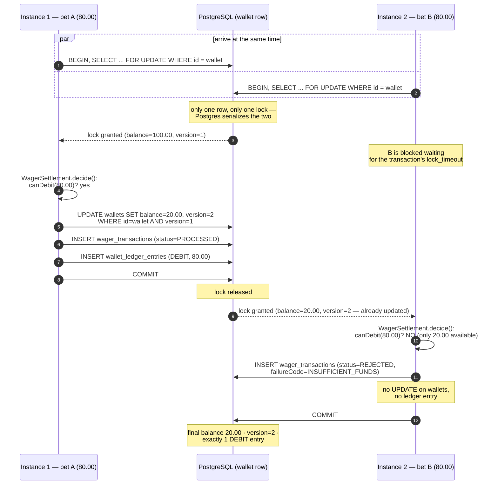
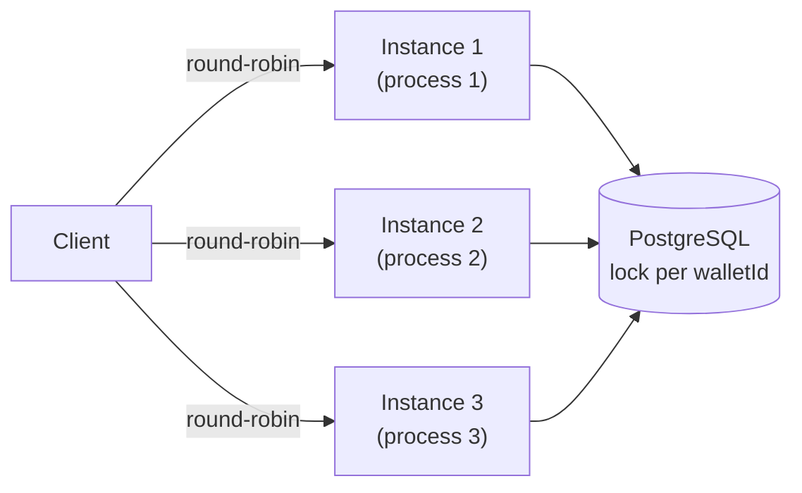

# Concurrency: two bets disputing the same wallet

Mandatory scenario from the spec: initial balance `100.00 BRL`, two bets of `80.00 BRL`
processed **simultaneously** (by any combination of instances). Expected result:
exactly one `PROCESSED`, the other `REJECTED` with `INSUFFICIENT_FUNDS`, final balance `20.00`,
exactly **one** `DEBIT` entry.

The unit of concurrency is the `walletId`. The strategy is a pessimistic lock (`SELECT ... FOR UPDATE`)
plus an optimistic `version` check on `UPDATE` — belt and suspenders (ADR-010 in
`ARCHITECTURE.en.md`).

## Why this remains correct with 3+ instances

The diagram above does not change at all if "Instance 1"/"Instance 2" are completely different
operating system processes, each with its own connection pool — the serialization point is the
**Postgres row**, not shared application memory. No instance keeps business state in memory
(ADR-012); any replica can serve any request.

## What happens if the lock takes too long

Each transaction has its own `lock_timeout`/`statement_timeout` (`MikroTransactionManager`).
If the lock is not granted in time (hot wallet under extreme load, or a bug holding the
transaction for too long), Postgres cancels it with SQLSTATE `55P03`
(`isTransientDatabaseError`/`isLockConflict` in `pg-error.ts`) and the application responds **503**
with `Retry-After`, with no effect at all — it never holds the whole instance waiting forever. This
also increments the `database_lock_conflicts_total` metric (see
[observability.md](./observability.md)).

## Where this is proven

| Test | Granularity |
|---|---|
| `test/concurrency/single-instance.test.ts` | Same process, real `Promise.all` |
| `test/concurrency/multi-instance.test.ts` | **3 real OS processes** (`bun src/main.ts`), same database |
| `test/integration/http/wagering.http.test.ts` | HTTP version of the scenario, end to end |
| `test/resilience/restart-consistency.test.ts` | The same principle, under real `SIGKILL`/`SIGTERM` |

Final invariant verified in all of them: `wallet.balance == balance reconstructed from the ledger`
(`test/support/invariants.ts`).
