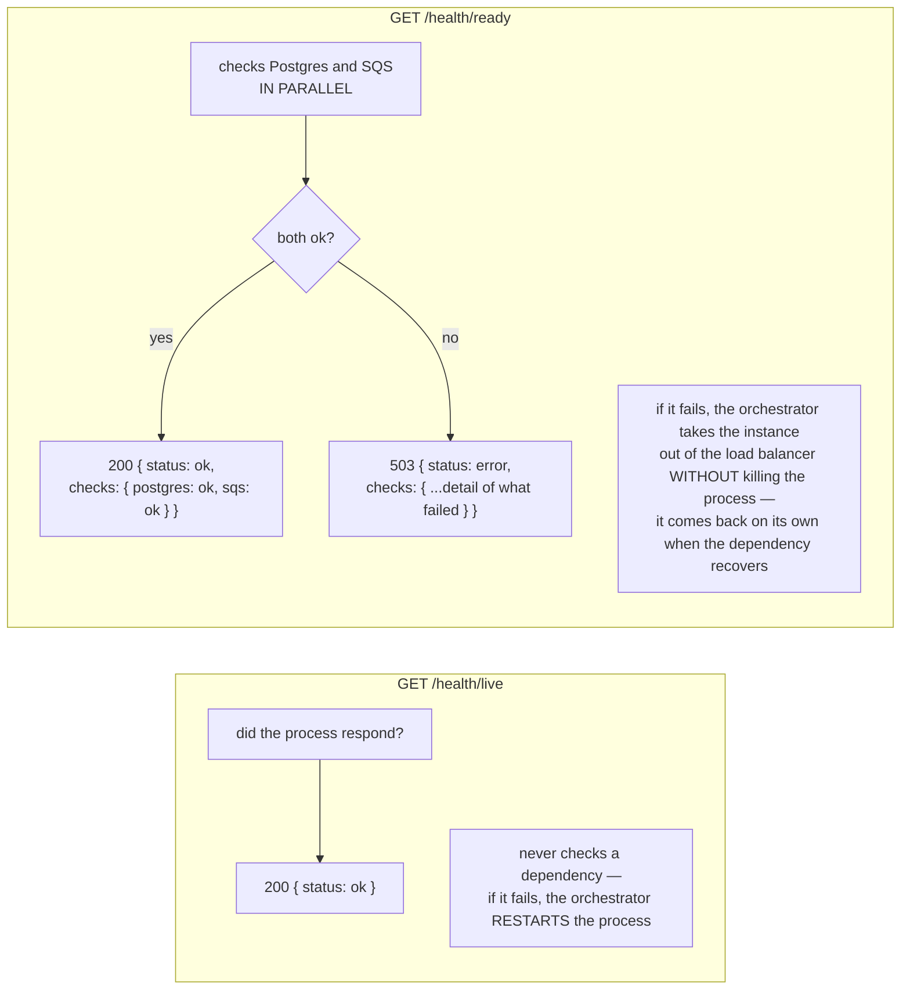
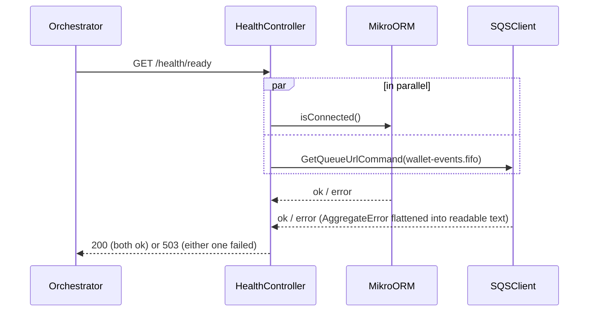
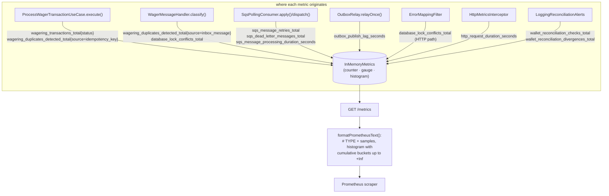

# Observability: health checks and metrics

## `/health/live` vs. `/health/ready`

If the instance has no role that uses the queue (SQS not configured), the SQS check becomes
`"skipped"` instead of failing — it is not treated as unavailability.

## `/metrics` (Prometheus)

| Metric | Type | What it tells you |
|---|---|---|
| `wagering_transactions_total{status}` | counter | volume by outcome |
| `wagering_duplicates_detected_total{source}` | counter | actual resend/redelivery happening |
| `sqs_message_retries_total` / `sqs_dead_letter_messages_total{reason}` | counter | consumer health; `reason` points to the cause |
| `database_lock_conflicts_total{sql_state}` | counter | real contention (hot wallet) |
| `outbox_publish_lag_seconds` | gauge | relay's delay in publishing what is already committed |
| `http_request_duration_seconds` / `sqs_message_processing_duration_seconds` | histogram | end-to-end latency, per route/queue |

## Files

- `src/platform/health/health.controller.ts`
- `src/platform/observability/metrics.ts`, `metrics.controller.ts`, `prometheus-format.ts`,
  `http-metrics.interceptor.ts`
- `test/integration/observability/metrics.test.ts`
