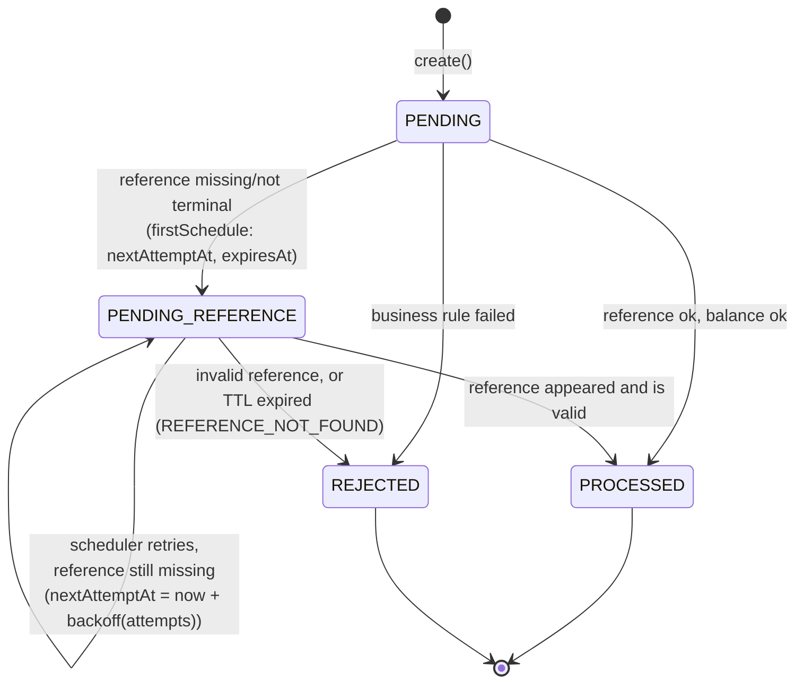
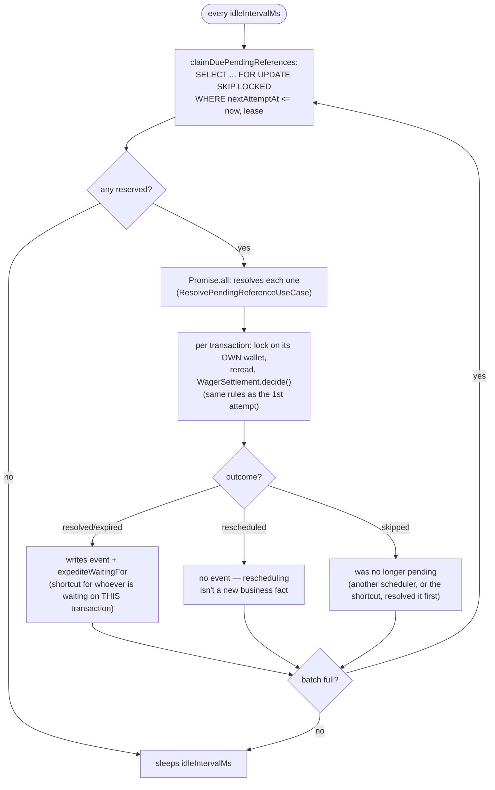

# Out-of-order references

At-least-once delivery doesn't guarantee order: a `REFUND` or `ROLLBACK` may arrive **before** the
transaction it references. Instead of rejecting it, the system waits.

## First attempt: the reference doesn't exist (yet)

Inside [`WagerSettlement.decide()`](./settlement-rules.md), if the reference doesn't exist or
isn't terminal yet, the transaction becomes `PENDING_REFERENCE` with a schedule
(`ReferenceLookupPolicy.firstSchedule`): first retry in 1s, doubling each attempt
(exponential backoff, jitter), and an `expiresAt` (TTL — 15 min by default,
`PENDING_REFERENCE_TTL_MS`).

## The scheduler (`PendingReferenceScheduler`, `scheduler` role)

Pending items from different wallets resolve in parallel (`Promise.all`); pending items from the
**same** wallet are serialized by the wallet's lock, inside the use case itself — the scheduler
doesn't need to worry about it.

## The shortcut (`expediteWaitingFor`)

When a transaction finishes (becomes `PROCESSED` or `REJECTED`), whoever was waiting on **it**
— for example, a `ROLLBACK` of a `REFUND` that was just resolved — doesn't need to wait for the
next backoff tick: `expediteWaitingFor(providerId, externalTransactionId, now)` moves up the
`nextAttemptAt` of whoever references it to now. This is called both when the transaction is new
(`ProcessWagerTransactionUseCase`) and when a pending item is resolved
(`ResolvePendingReferenceUseCase`) — a `BET` → `WIN` → `ROLLBACK(WIN)` chain delivered out of
order resolves in cascade, without waiting for multiple polling cycles.

## Files

- `src/modules/wagering/application/use-cases/reference-lookup.policy.ts` — backoff and TTL.
- `src/modules/wagering/application/use-cases/resolve-pending-reference.use-case.ts` — reprocessing.
- `src/modules/wagering/infrastructure/scheduler/pending-reference.scheduler.ts` — the loop.
- `test/integration/wagering/pending-references.test.ts` — expired TTL, cascade, idempotency of the final result.
