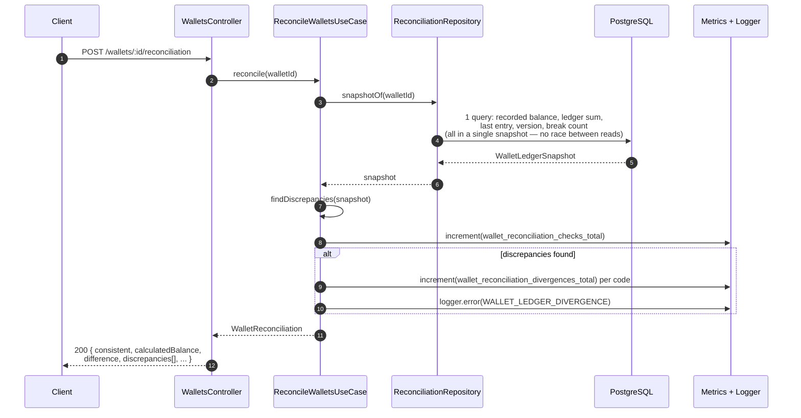

# Reconciliation

`POST /wallets/:walletId/reconciliation` — read-only. Compares the balance recorded on the wallet
with the balance rebuilt from the ledger. **Never silently fixes anything**: a discrepancy is
logged, counted in a metric, and returned in the response (200 — it's a finding, not a request
error).

## Discrepancy codes (`findDiscrepancies`)

| Code | When |
|---|---|
| `BALANCE_MISMATCH` | recorded balance ≠ ledger sum (the check required by the spec) |
| `LAST_ENTRY_MISMATCH` | recorded balance ≠ last entry's `balanceAfter` |
| `VERSION_MISMATCH` | wallet's `version` ≠ last entry's version (or ≠ 1 with no entries) |
| `LEDGER_CHAIN_BROKEN` | an entry doesn't start where the previous one ended |
| `LEDGER_VERSION_GAP` | an entry is missing in the `walletVersion` sequence |

More than one code can appear in the same response — they are not mutually exclusive.

## Reconciliation of all wallets

`ReconcileWalletsUseCase.reconcileAll(pageSize)` scans in pages (not by streaming), returns only
the divergent ones, and records the summary (`wallet_reconciliation_last_run_wallets`/
`..._divergent_wallets`) — this is what `bun run reconcile` runs as an operational command
(`scripts/reconcile.ts`).

## Files

- `src/modules/wallet/application/use-cases/reconcile-wallets.use-case.ts`
- `src/modules/wallet/application/ports/reconciliation.repository.ts` — snapshot shape.
- `src/modules/wallet/infrastructure/reconciliation/logging-reconciliation-alerts.ts` — log + metric.
- `test/integration/wallet/reconciliation.test.ts` — including simulated corruption (trigger
  manually disabled) to prove the discrepancy is detected and not fixed.
