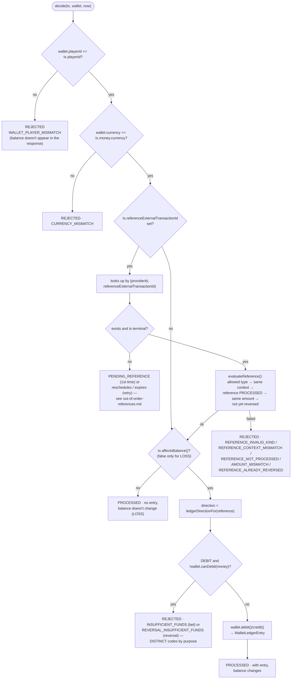

# Settlement rules (`WagerSettlement.decide`)

`src/modules/wagering/application/use-cases/wager-settlement.ts` — the business decision, always
called **under the wallet's lock**. It is shared by whoever processes the transaction for the
first time (HTTP or SQS, via `ProcessWagerTransactionUseCase`) and by whoever reprocesses a
pending item (the scheduler, via `ResolvePendingReferenceUseCase`) — the rules are exactly the
same in both cases.

## Operations table

| `kind` | Effect on balance | Ledger | Can reference |
|---|---|---|---|
| `BET` | debit | 1 `DEBIT` | — |
| `WIN` | credit | 1 `CREDIT` | `BET` (optional, same round) |
| `LOSS` | none | none | — |
| `REFUND` | credit (reverses the `BET`) | 1 `CREDIT` | `BET` (required) |
| `ROLLBACK` | inverse of the reference | 1 inverted entry | `BET`, `WIN` or `REFUND` (required) |

## Reference rules (`evaluateReference`, pure domain — `reference-policy.ts`)

Checking order, from most structural to most circumstantial — the first one that fails decides
the `failureCode`:

1. **Allowed type**: `WIN`/`REFUND` can only reference `BET`; `ROLLBACK` references `BET`, `WIN` or
   `REFUND`. Otherwise → `REFERENCE_INVALID_KIND`.
2. **Same context**: the reference's `providerId`, `playerId`, `walletId`, currency, and `roundId`
   must match the transaction's. → `REFERENCE_CONTEXT_MISMATCH`.
3. **Reference applied**: can only reference a `PROCESSED` transaction. → `REFERENCE_NOT_PROCESSED`.
4. **Same amount** (only for `REFUND`/`ROLLBACK`): partial reversal is out of scope. → `AMOUNT_MISMATCH`.
5. **Not yet reversed** (only for `REFUND`/`ROLLBACK`): a reference cannot be reversed
   twice by the same operation type. → `REFERENCE_ALREADY_REVERSED`.

## Why `INSUFFICIENT_FUNDS` and `REVERSAL_INSUFFICIENT_FUNDS` are different codes

A bet with no balance (`BET`) and a reversal that would leave the balance negative (`ROLLBACK` of
a `WIN` already spent) are **operationally different situations** — the first is the player
losing normally; the second is a sign that something already consumed the prize before the
reversal arrived, and may require investigation. That's why
`WagerTransaction.insufficientFundsFailureCode()` returns a distinct code depending on the `kind`
of the transaction being rejected, and both remain auditable (the transaction is persisted as
`REJECTED`, never discarded).

## Replaying a pending item uses the same function

`ResolvePendingReferenceUseCase` (`resolve-pending-reference.use-case.ts`) calls the **same**
`WagerSettlement.decide()` — the only difference is what happens when the reference is still
unavailable: on the first attempt it becomes `PENDING_REFERENCE`; on a retry, it becomes a new
reschedule or, if the TTL expired, `REJECTED · REFERENCE_NOT_FOUND`. See
[out-of-order-references.md](./out-of-order-references.md).

## Files

- `src/modules/wagering/application/use-cases/wager-settlement.ts`
- `src/modules/wagering/domain/reference-policy.ts`
- `src/modules/wagering/domain/entities/wager-transaction.ts` (`ledgerDirectionFor`,
  `insufficientFundsFailureCode`, `affectsBalance`, `isReversal`)
- `src/modules/wagering/error/failure-code.ts` — full `failureCode` taxonomy
