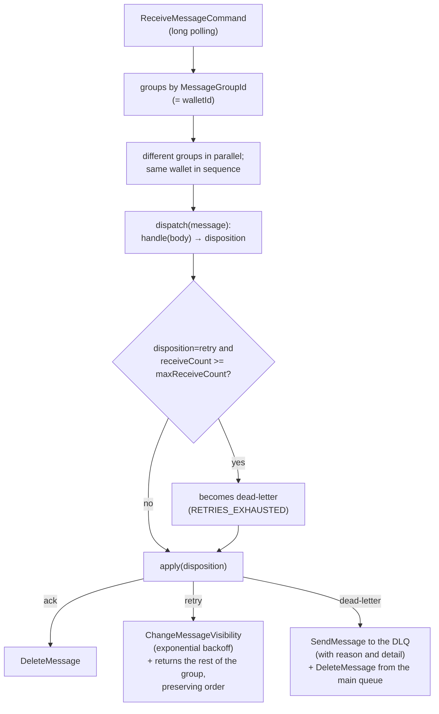
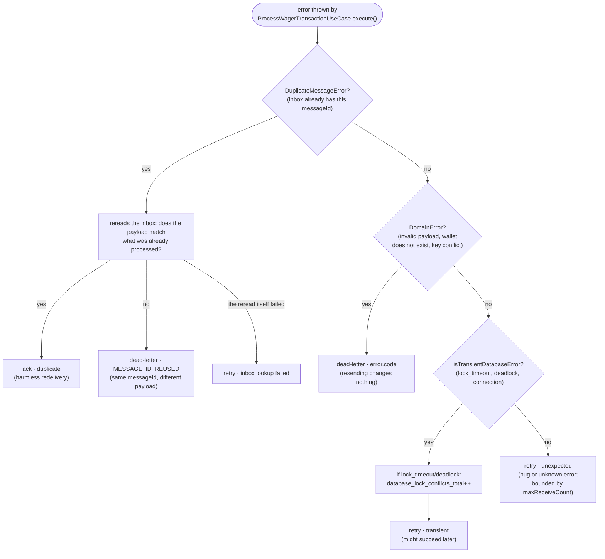
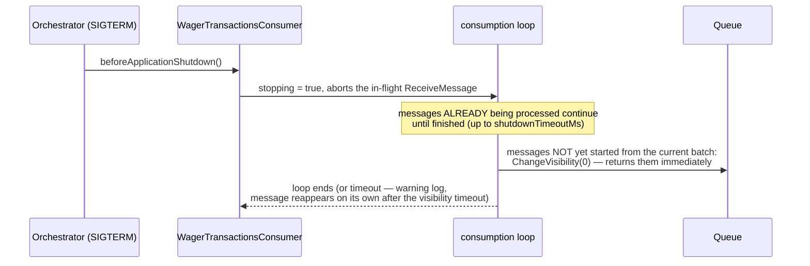

# SQS messaging: consumption, retry, and DLQ

`SqsPollingConsumer` (`src/modules/messaging/infrastructure/sqs/sqs-polling-consumer.ts`) is
generic — what decides what to do with each message is the injected `handle`, which for
`wager-transactions.fifo` is the `WagerMessageHandler`
(`src/modules/wagering/infrastructure/sqs/wager-message.handler.ts`), calling the **same**
`ProcessWagerTransactionUseCase` as the HTTP API.

## Consumption loop

## How the handler classifies each error (`WagerMessageHandler.classify`)

## `SIGTERM`: finishes what is in progress, returns the rest

## Important points

- **Ack only after commit**: the consumer's `handle` only returns `ack` after
  `ProcessWagerTransactionUseCase.execute()` has already returned successfully — and that only
  happens after the SQL transaction's `COMMIT`. Killing the process between the commit and the ack
  (tested with a real `SIGKILL` in `test/resilience/consumer-failures.test.ts`) is safe: the
  message reappears, the inbox already has the `messageId` processed, and the handler returns
  `ack · duplicate` without reapplying the effect.
- **Order preserved per group**: a `retry` on one message also returns the **rest of the same
  group** (same wallet) to the queue, instead of processing them out of order.
- **DLQ carries the reason**: `dlq-reason` and `dlq-detail` go as message attributes — whoever
  looks at the DLQ knows why that message is there without having to cross-reference logs.

## Files

- `src/modules/messaging/infrastructure/sqs/sqs-polling-consumer.ts` — generic loop.
- `src/modules/wagering/infrastructure/sqs/wager-message.handler.ts` — classification specific
  to the wagering domain.
- `src/modules/wagering/infrastructure/sqs/wager-transactions.consumer.ts` — wires the two
  together, only on instances with the `consumer` role.
- `test/resilience/consumer-failures.test.ts` — real `SIGKILL`/`SIGTERM`.
