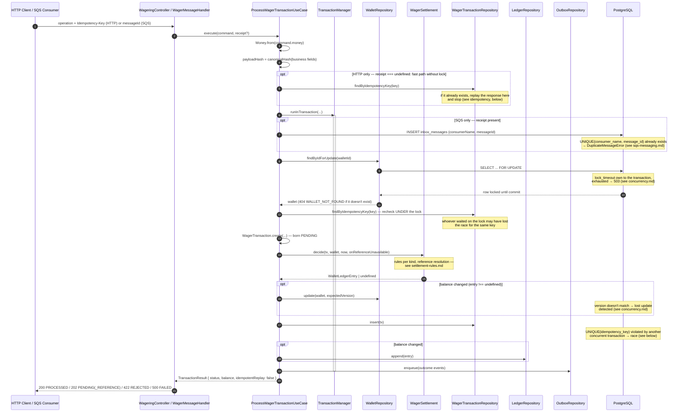
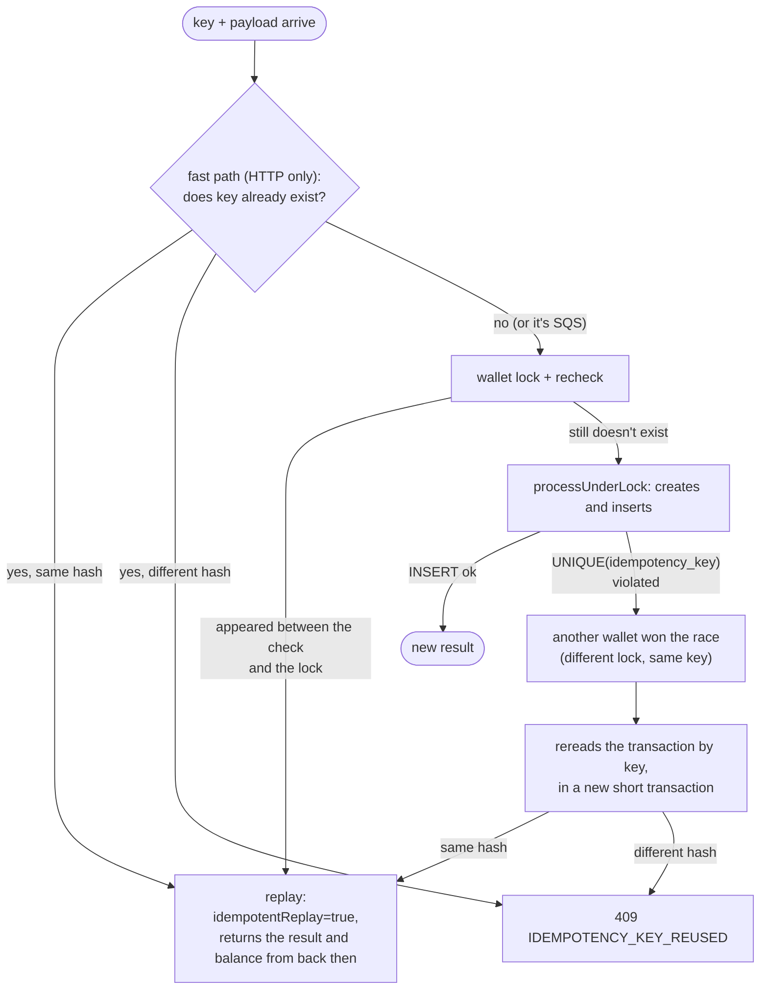

# Processing a wager transaction

The system's central flow. `POST /wagering/transactions` (HTTP) and consuming
`wager-transactions.fifo` (SQS) call **the same use case** —
`ProcessWagerTransactionUseCase.execute()`
(`src/modules/wagering/application/use-cases/process-wager-transaction.use-case.ts`) — there is no
duplicated business logic between the two channels.

## Full flow (happy path: new transaction, PROCESSED)

## Idempotency: replay vs. race vs. conflict

This last branch (`Race`) is the only way two requests with the **same key** but
**different wallets** can collide: since the lock is per wallet, they don't compete for the same
lock — whoever commits first writes the key; the other one receives `DuplicateWagerTransactionError`
from the database (`UNIQUE(idempotency_key)`), rereads in a new transaction, and decides replay or
conflict. See `ARCHITECTURE.en.md` (ADR-011) for the exact `payloadHash` algorithm.

## Differences between the HTTP channel and the SQS channel

| | HTTP | SQS |
|---|---|---|
| Request identity | `Idempotency-Key` (header) | envelope's `messageId` |
| Fast path without lock | Yes | No — always enters the transaction (needs to write the inbox anyway) |
| Deduplication record | Only `UNIQUE(idempotency_key)` | Inbox (`consumerName`, `messageId`) **and** the idempotency key |
| Confirmation to the caller | Synchronous HTTP response | `ack` **only after commit** (see [sqs-messaging.md](./sqs-messaging.md)) |
| Redelivery | Client decides to resend | SQS redelivers on its own; the inbox guarantees the effect doesn't duplicate |

## Files

- `src/modules/wagering/application/use-cases/process-wager-transaction.use-case.ts` — orchestration.
- `src/modules/wagering/application/use-cases/payload-hash.ts` + `src/shared/util/canonical-hash.ts` — `payloadHash`.
- `src/modules/wagering/presentation/controllers/wagering.controller.ts` — HTTP entry point.
- `src/modules/wagering/infrastructure/sqs/wager-message.handler.ts` — SQS entry point.
