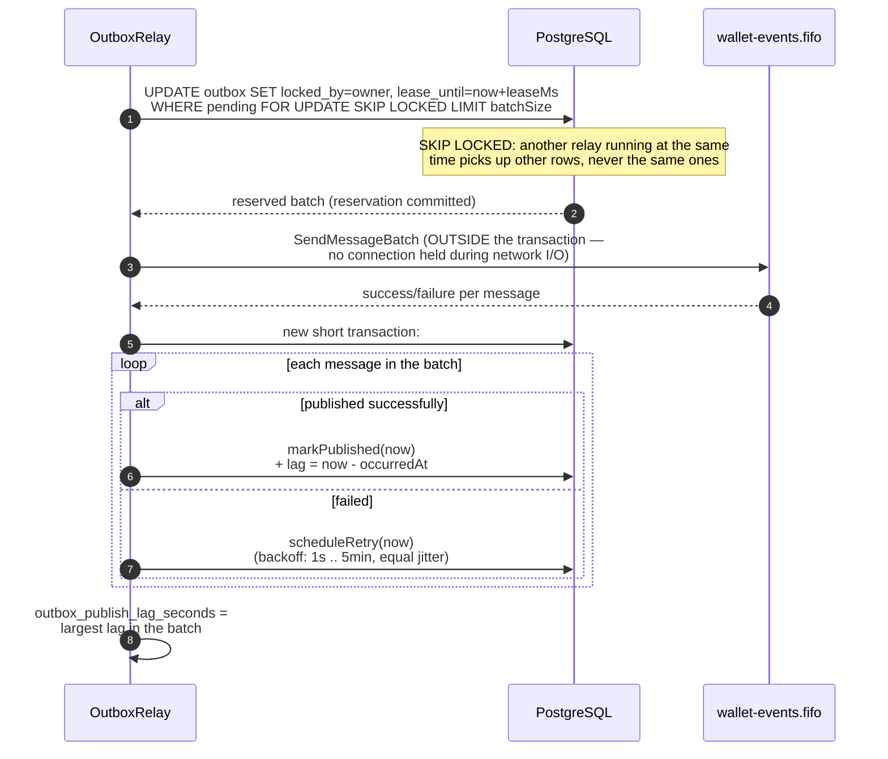
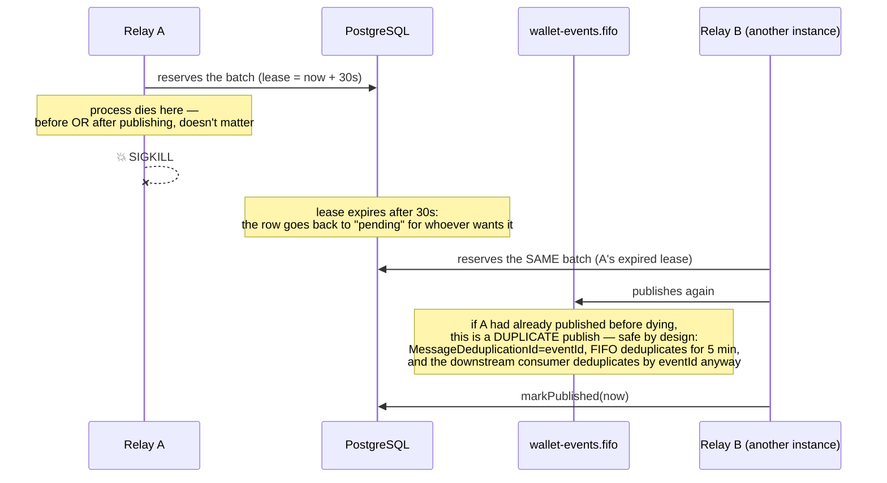

# Transactional outbox and the relay

The integration event is born as a **row in the `outbox` table**, written in the same SQL
transaction as the financial effect (see [transaction-processing.md](./transaction-processing.md)) —
it is never published right away. A separate worker, the `OutboxRelay`
(`src/modules/messaging/application/use-cases/outbox-relay.ts`), publishes it later, outside the
transaction, and there can be **several concurrent publishers** without losing or indefinitely
duplicating events.

## One relay round

## Crash scenario (the one required by the spec)

Delivery is **at-least-once**, never at-most-once — losing a confirmed event is a disqualifying
failure per the spec; publishing it twice is an accepted and handled consequence.

## The 4 minimum events

| Event | When | Carries |
|---|---|---|
| `WagerTransactionProcessed` | any applied transaction, **including `LOSS`** | transaction summary |
| `WagerTransactionRejected` | rejected by a business rule | `failureCode` |
| `WalletBalanceChanged` | **only** when the balance changes (never on `LOSS`) | balance before/after, direction, `walletVersion` |
| `WagerTransactionPendingReference` | reference missing on the first attempt | — |

All of these are concrete subclasses of `IntegrationEvent<T>` (`src/shared/domain/integration-event.ts`)
— `eventType`/`version` live **in the type**, never a loose string at the call site — and `data`
always carries `MoneyProps` (string), never the `Money` instance.

## Files

- `src/modules/messaging/application/use-cases/outbox-relay.ts` — the round's logic.
- `src/modules/messaging/infrastructure/relay/outbox-relay.worker.ts` — the loop, only on instances
  with the `relay` role.
- `src/modules/messaging/infrastructure/sqs/sqs-event-publisher.ts` — the actual publishing (SQS).
- `src/modules/wagering/domain/events/*.event.ts` — the 4 event subclasses.
- `test/integration/messaging/outbox-relay.test.ts` — multiple concurrent publishers, in-process.
- `test/resilience/relay-failures.test.ts` — the crash scenario, with a real `SIGKILL` across 3 processes.
