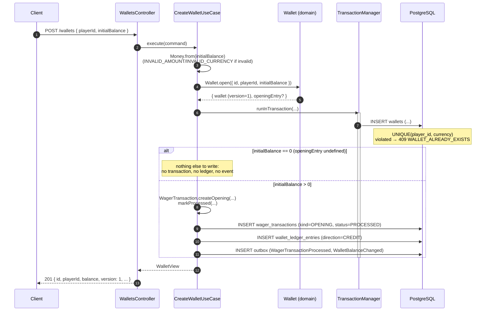

# Wallet creation

`POST /wallets` — `src/modules/wallet/presentation/controllers/wallets.controller.ts` →
`src/modules/wallet/application/use-cases/create-wallet.use-case.ts`

When the initial balance is greater than zero, opening the wallet generates an internal `OPENING`
transaction (the only way `OPENING` can exist — it is never submitted via the API nor the queue)
with a corresponding `CREDIT` entry, and the two integration events — all within the **same
SQL transaction** that inserts the wallet.

## Important points

- **The `providerId` of the OPENING transaction is `"system"`**, reserved — no real provider can
  use it (`RESERVED_PROVIDER` if attempted).
- **Zero balance leaves no trace at all**: no `wager_transactions`, no `wallet_ledger_entries`,
  no event — only the row in `wallets`, with `version = 1`.
- The actual publication to the queue (`wallet-events.fifo`) **does not happen here**: the events
  only become rows in the `outbox` table; the one who publishes them is the relay (see
  [transactional-outbox.md](./transactional-outbox.md)).
- A duplicate wallet conflict (same `playerId` + `currency`) is caught by the database's
  `uq_wallets_player_currency` constraint, not only by an in-memory check — which is why it is
  safe even with two instances creating the same wallet at the same time.
