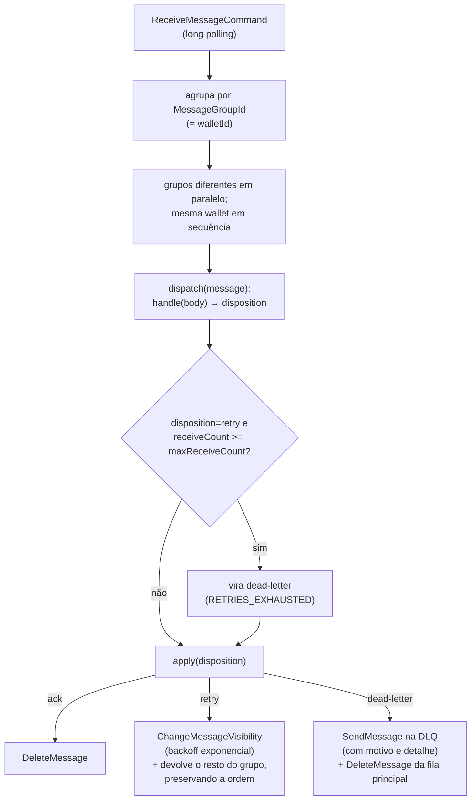
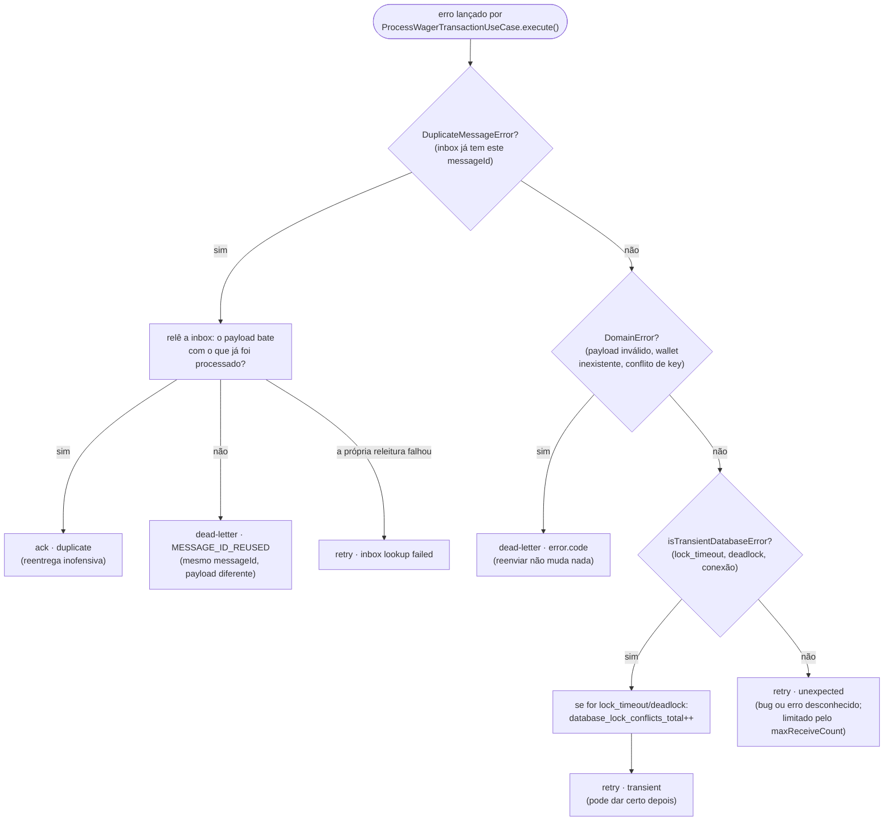
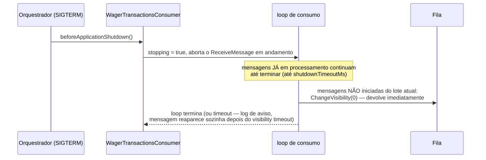

# Mensageria SQS: consumo, retry e DLQ

`SqsPollingConsumer` (`src/modules/messaging/infrastructure/sqs/sqs-polling-consumer.ts`) é
genérico — quem decide o que fazer com cada mensagem é o `handle` injetado, que pra
`wager-transactions.fifo` é o `WagerMessageHandler`
(`src/modules/wagering/infrastructure/sqs/wager-message.handler.ts`), chamando o **mesmo**
`ProcessWagerTransactionUseCase` da API HTTP.

## Loop de consumo

## Como o handler classifica cada erro (`WagerMessageHandler.classify`)

## `SIGTERM`: termina o que está em andamento, devolve o resto

## Pontos importantes

- **Ack só depois do commit**: o `handle` do consumer só devolve `ack` depois que
  `ProcessWagerTransactionUseCase.execute()` já retornou com sucesso — e isso só acontece depois
  do `COMMIT` da transação SQL. Matar o processo entre o commit e o ack (testado com `SIGKILL`
  real em `test/resilience/consumer-failures.test.ts`) é seguro: a mensagem reaparece, a inbox
  já tem o `messageId` processado, e o handler devolve `ack · duplicate` sem reaplicar o efeito.
- **Ordem preservada por grupo**: um `retry` numa mensagem devolve o **resto do mesmo grupo**
  (mesma wallet) pra fila também, em vez de processá-las fora de ordem.
- **DLQ carrega o motivo**: `dlq-reason` e `dlq-detail` vão como atributos da mensagem — quem
  olha a DLQ sabe por que aquela mensagem está lá sem precisar cruzar com log.

## Arquivos

- `src/modules/messaging/infrastructure/sqs/sqs-polling-consumer.ts` — loop genérico.
- `src/modules/wagering/infrastructure/sqs/wager-message.handler.ts` — classificação específica
  do domínio de wagering.
- `src/modules/wagering/infrastructure/sqs/wager-transactions.consumer.ts` — liga os dois,
  só nas instâncias com o papel `consumer`.
- `test/resilience/consumer-failures.test.ts` — `SIGKILL`/`SIGTERM` reais.
