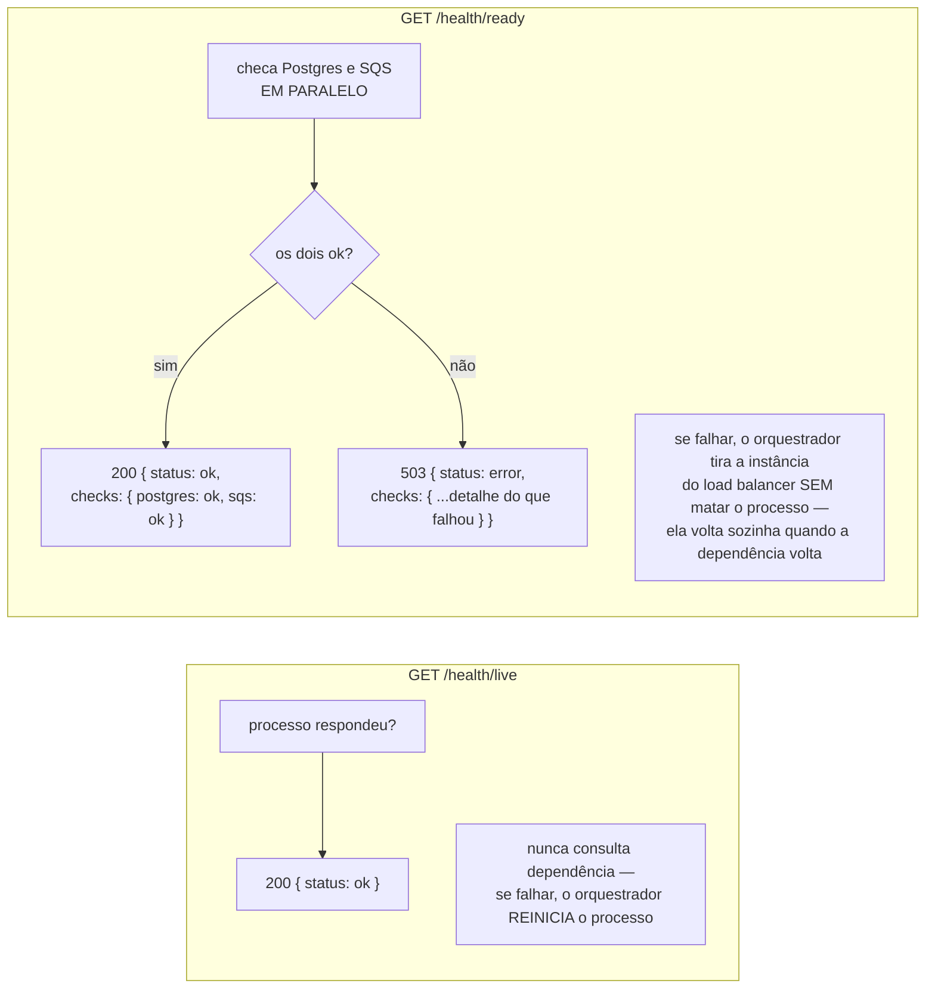
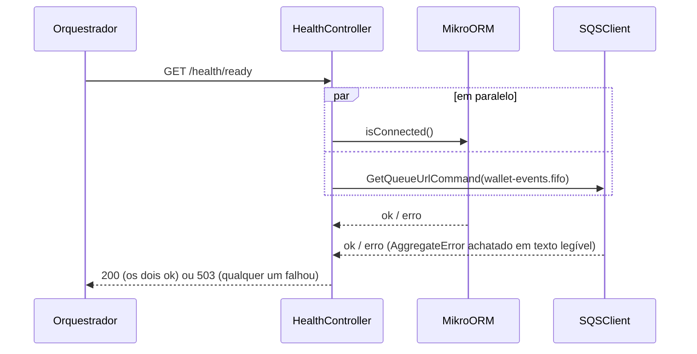
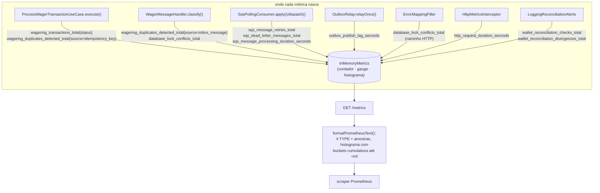

# Observabilidade: health checks e métricas

## `/health/live` vs. `/health/ready`

Se a instância não tiver papel que use fila (SQS não configurado), o check de SQS vira
`"skipped"` em vez de falhar — não é tratado como indisponibilidade.

## `/metrics` (Prometheus)

| Métrica | Tipo | O que diz |
|---|---|---|
| `wagering_transactions_total{status}` | counter | volume por desfecho |
| `wagering_duplicates_detected_total{source}` | counter | reenvio/reentrega de verdade acontecendo |
| `sqs_message_retries_total` / `sqs_dead_letter_messages_total{reason}` | counter | saúde do consumer; `reason` aponta a causa |
| `database_lock_conflicts_total{sql_state}` | counter | contenção real (hot wallet) |
| `outbox_publish_lag_seconds` | gauge | atraso do relay em publicar o que já está confirmado |
| `http_request_duration_seconds` / `sqs_message_processing_duration_seconds` | histogram | latência ponta a ponta, por rota/fila |

## Arquivos

- `src/platform/health/health.controller.ts`
- `src/platform/observability/metrics.ts`, `metrics.controller.ts`, `prometheus-format.ts`,
  `http-metrics.interceptor.ts`
- `test/integration/observability/metrics.test.ts`
