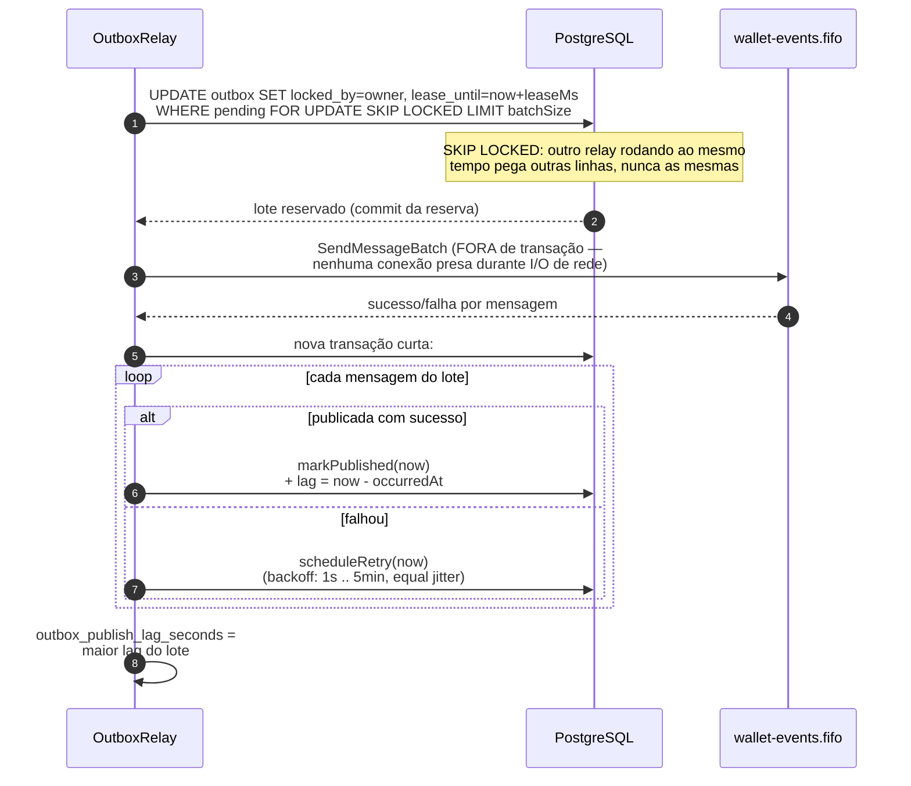
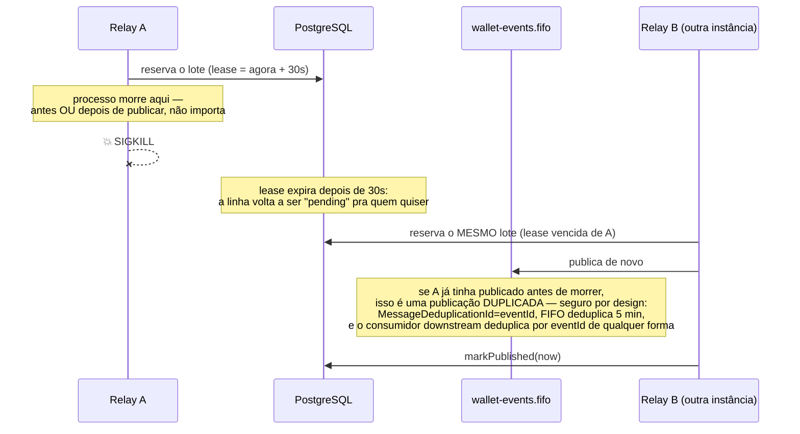

# Outbox transacional e o relay

O evento de integração nasce como **linha na tabela `outbox`**, gravado na mesma transação SQL
do efeito financeiro (ver [processamento-de-transacao.md](./processamento-de-transacao.md)) —
nunca é publicado na hora. Um worker separado, o `OutboxRelay`
(`src/modules/messaging/application/use-cases/outbox-relay.ts`), publica depois, fora da
transação, e pode haver **vários publishers concorrentes** sem perder nem duplicar
indefinidamente.

## Uma rodada do relay

## Cenário de crash (o exigido pelo enunciado)

Entrega **at-least-once**, nunca at-most-once — perder um evento confirmado é uma falha
eliminatória do enunciado; publicá-lo duas vezes é uma consequência aceita e tratada.

## Os 4 eventos mínimos

| Evento | Quando | Carrega |
|---|---|---|
| `WagerTransactionProcessed` | qualquer transação aplicada, **inclusive `LOSS`** | resumo da transação |
| `WagerTransactionRejected` | rejeitada por regra de negócio | `failureCode` |
| `WalletBalanceChanged` | **somente** quando o saldo muda (nunca em `LOSS`) | saldo antes/depois, direção, `walletVersion` |
| `WagerTransactionPendingReference` | referência ausente na primeira tentativa | — |

Todos são subclasses concretas de `IntegrationEvent<T>` (`src/shared/domain/integration-event.ts`)
— `eventType`/`version` ficam **no tipo**, nunca uma string solta no call site — e o `data`
carrega sempre `MoneyProps` (string), nunca a instância de `Money`.

## Arquivos

- `src/modules/messaging/application/use-cases/outbox-relay.ts` — a lógica da rodada.
- `src/modules/messaging/infrastructure/relay/outbox-relay.worker.ts` — o loop, só nas instâncias
  com o papel `relay`.
- `src/modules/messaging/infrastructure/sqs/sqs-event-publisher.ts` — publicação de verdade (SQS).
- `src/modules/wagering/domain/events/*.event.ts` — as 4 subclasses de evento.
- `test/integration/messaging/outbox-relay.test.ts` — múltiplos publishers concorrentes, in-process.
- `test/resilience/relay-failures.test.ts` — o cenário de crash, com `SIGKILL` real em 3 processos.
