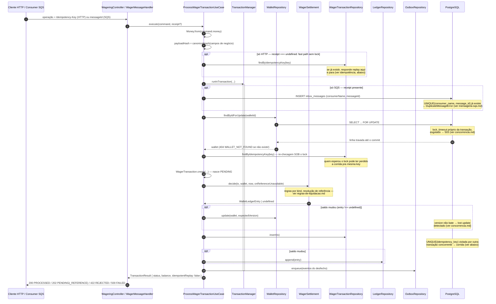
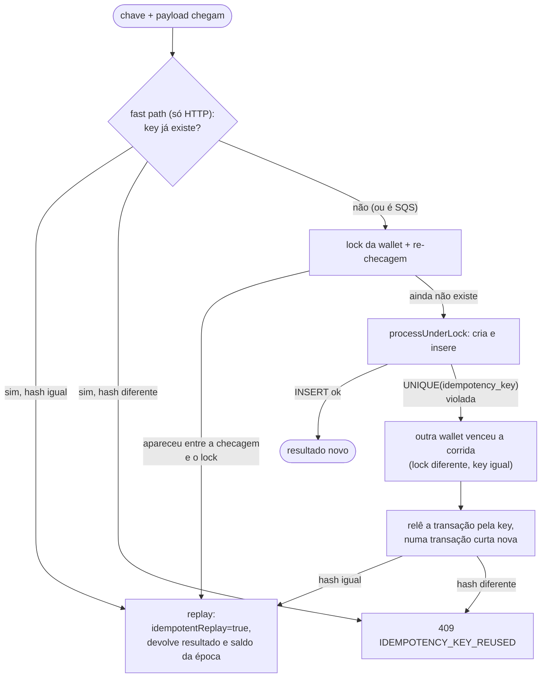

# Processamento de uma transação de aposta

O fluxo central do sistema. `POST /wagering/transactions` (HTTP) e o consumo de
`wager-transactions.fifo` (SQS) chamam **o mesmo caso de uso** —
`ProcessWagerTransactionUseCase.execute()`
(`src/modules/wagering/application/use-cases/process-wager-transaction.use-case.ts`) — não existe
lógica de negócio duplicada entre os dois canais.

## Fluxo completo (caminho feliz: transação nova, PROCESSED)

## Idempotência: replay vs. corrida vs. conflito

Esse último ramo (`Race`) é o único jeito de duas requisições com a **mesma key** mas
**wallets diferentes** colidirem: como o lock é por wallet, elas não disputam o mesmo lock —
quem commita primeiro grava a key; a outra recebe `DuplicateWagerTransactionError` do banco
(`UNIQUE(idempotency_key)`), relê numa transação nova e decide replay ou conflito. Ver
`ARCHITECTURE.md` (ADR-011) para o algoritmo exato do `payloadHash`.

## Diferenças entre o canal HTTP e o canal SQS

| | HTTP | SQS |
|---|---|---|
| Identidade da requisição | `Idempotency-Key` (header) | `messageId` do envelope |
| Fast path sem lock | Sim | Não — sempre entra na transação (precisa gravar a inbox de qualquer forma) |
| Registro de deduplicação | Só a `UNIQUE(idempotency_key)` | Inbox (`consumerName`, `messageId`) **e** a idempotency key |
| Confirmação pro chamador | Resposta HTTP síncrona | `ack` **só depois do commit** (ver [mensageria-sqs.md](./mensageria-sqs.md)) |
| Reentrega | Cliente decide reenviar | SQS reentrega sozinho; a inbox garante que o efeito não duplica |

## Arquivos

- `src/modules/wagering/application/use-cases/process-wager-transaction.use-case.ts` — orquestração.
- `src/modules/wagering/application/use-cases/payload-hash.ts` + `src/shared/util/canonical-hash.ts` — `payloadHash`.
- `src/modules/wagering/presentation/controllers/wagering.controller.ts` — entrada HTTP.
- `src/modules/wagering/infrastructure/sqs/wager-message.handler.ts` — entrada SQS.
