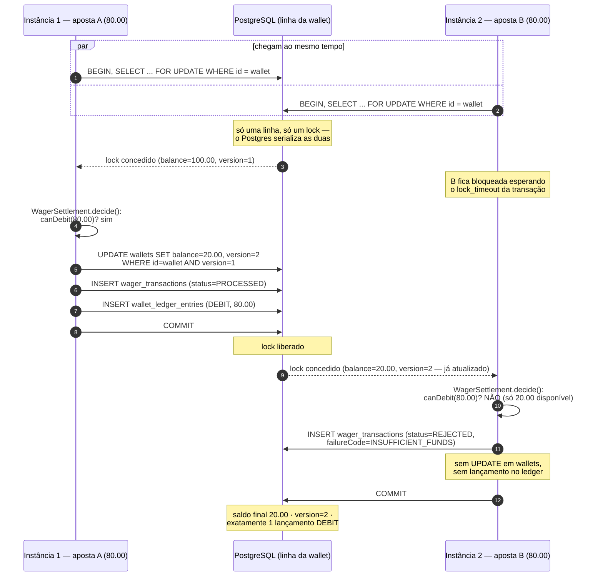
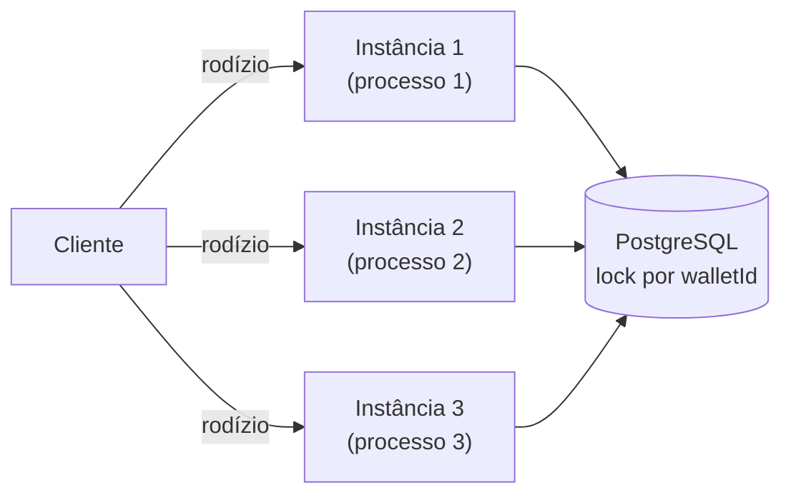

# Concorrência: duas apostas disputando a mesma wallet

Cenário obrigatório do enunciado: saldo inicial `100.00 BRL`, duas apostas de `80.00 BRL`
processadas **simultaneamente** (por qualquer combinação de instâncias). Resultado esperado:
exatamente uma `PROCESSED`, a outra `REJECTED` por `INSUFFICIENT_FUNDS`, saldo final `20.00`,
exatamente **um** lançamento `DEBIT`.

A unidade de concorrência é a `walletId`. A estratégia é lock pessimista (`SELECT ... FOR UPDATE`)
mais uma checagem otimista de `version` no `UPDATE` — cinto e suspensório (ADR-010 no
`ARCHITECTURE.pt.md`).

## Por que isso continua correto com 3+ instâncias

O diagrama acima não muda nada se "Instância 1"/"Instância 2" forem processos de sistema
operacional completamente diferentes, cada um com seu próprio pool de conexão — o ponto de
serialização é a **linha do Postgres**, não memória compartilhada da aplicação. Nenhuma
instância guarda estado de negócio em memória (ADR-012); qualquer réplica atende qualquer
requisição.

## O que acontece se o lock demorar demais

Cada transação tem seu próprio `lock_timeout`/`statement_timeout` (`MikroTransactionManager`).
Se o lock não for concedido a tempo (hot wallet sob carga extrema, ou um bug segurando a
transação por tempo demais), o Postgres cancela com SQLSTATE `55P03`
(`isTransientDatabaseError`/`isLockConflict` em `pg-error.ts`) e a aplicação responde **503**
com `Retry-After`, sem efeito nenhum — nunca trava a instância inteira esperando pra sempre. Isso
também incrementa a métrica `database_lock_conflicts_total` (ver
[observabilidade.md](./observabilidade.md)).

## Onde isso é provado

| Teste | Granularidade |
|---|---|
| `test/concurrency/single-instance.test.ts` | Mesmo processo, `Promise.all` real |
| `test/concurrency/multi-instance.test.ts` | **3 processos de SO reais** (`bun src/main.ts`), mesmo banco |
| `test/integration/http/wagering.http.test.ts` | Versão HTTP do cenário, fim a fim |
| `test/resilience/restart-consistency.test.ts` | O mesmo princípio, sob `SIGKILL`/`SIGTERM` reais |

Invariante final verificada em todos: `wallet.balance == saldo reconstruído pelo ledger`
(`test/support/invariants.ts`).
