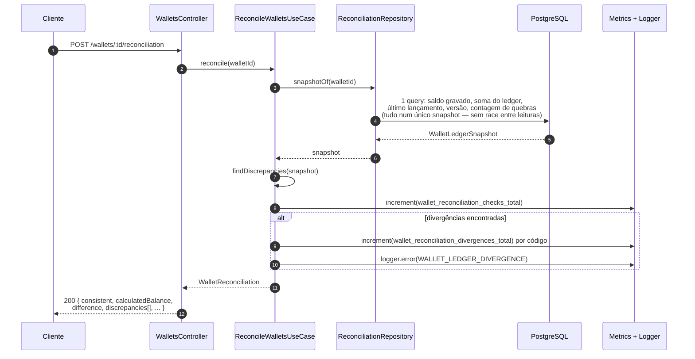

# Reconciliação

`POST /wallets/:walletId/reconciliation` — somente leitura. Compara o saldo gravado na wallet
com o saldo reconstruído a partir do ledger. **Nunca corrige nada silenciosamente**: uma
divergência é logada, contabilizada em métrica e devolvida na resposta (200 — é um achado, não
um erro da requisição).

## Códigos de divergência (`findDiscrepancies`)

| Código | Quando |
|---|---|
| `BALANCE_MISMATCH` | saldo gravado ≠ soma do ledger (a verificação exigida pelo enunciado) |
| `LAST_ENTRY_MISMATCH` | saldo gravado ≠ `balanceAfter` do último lançamento |
| `VERSION_MISMATCH` | `version` da wallet ≠ versão do último lançamento (ou ≠ 1 sem nenhum lançamento) |
| `LEDGER_CHAIN_BROKEN` | um lançamento não começa onde o anterior terminou |
| `LEDGER_VERSION_GAP` | falta um lançamento na sequência de `walletVersion` |

Mais de um código pode aparecer na mesma resposta — eles não são mutuamente exclusivos.

## Reconciliação de todas as wallets

`ReconcileWalletsUseCase.reconcileAll(pageSize)` varre em páginas (não por streaming), devolve só
as divergentes, e registra o resumo (`wallet_reconciliation_last_run_wallets`/
`..._divergent_wallets`) — é o que `bun run reconcile` roda como comando operacional
(`scripts/reconcile.ts`).

## Arquivos

- `src/modules/wallet/application/use-cases/reconcile-wallets.use-case.ts`
- `src/modules/wallet/application/ports/reconciliation.repository.ts` — forma do snapshot.
- `src/modules/wallet/infrastructure/reconciliation/logging-reconciliation-alerts.ts` — log + métrica.
- `test/integration/wallet/reconciliation.test.ts` — inclusive corrupção simulada (trigger
  desligado manualmente) pra provar que a divergência é detectada e não corrigida.
