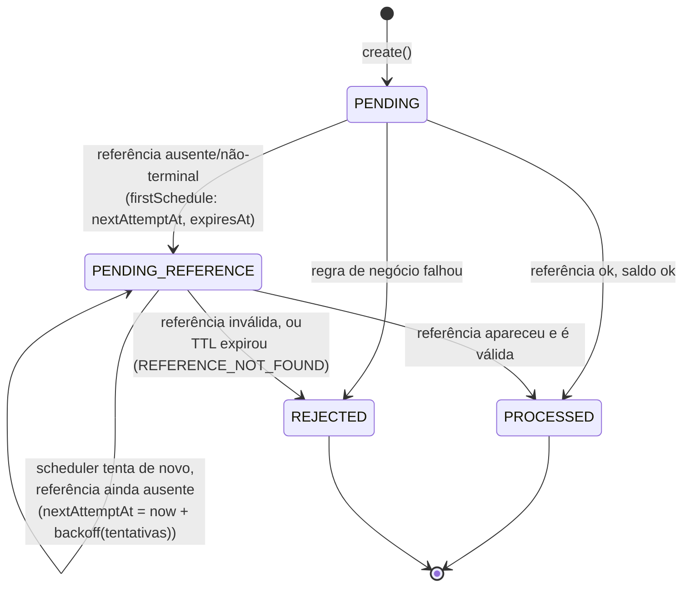
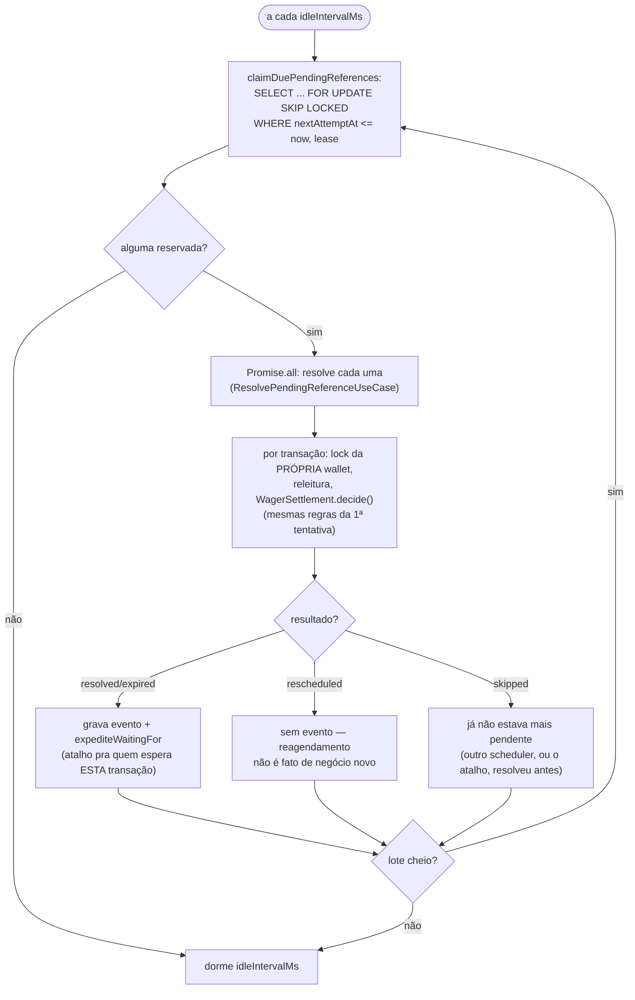

# Referências fora de ordem

Entrega at-least-once não garante ordem: um `REFUND` ou `ROLLBACK` pode chegar **antes** da
transação que ele referencia. Em vez de rejeitar, o sistema espera.

## Primeira tentativa: a referência não existe (ainda)

Dentro de [`WagerSettlement.decide()`](./regras-de-liquidacao.md), se a referência não existe ou
ainda não é terminal, a transação vira `PENDING_REFERENCE` com um agendamento
(`ReferenceLookupPolicy.firstSchedule`): primeira nova tentativa em 1s, dobrando a cada tentativa
(backoff exponencial, jitter), e um `expiresAt` (TTL — 15 min por padrão,
`PENDING_REFERENCE_TTL_MS`).

## O scheduler (`PendingReferenceScheduler`, papel `scheduler`)

Pendências de wallets diferentes resolvem em paralelo (`Promise.all`); pendências da **mesma**
wallet ficam serializadas pelo lock da wallet, dentro do próprio caso de uso — o scheduler não
precisa se preocupar com isso.

## O atalho (`expediteWaitingFor`)

Quando uma transação termina (vira `PROCESSED` ou `REJECTED`), quem estava esperando por **ela**
— por exemplo, um `ROLLBACK` de um `REFUND` que acabou de ser resolvido — não precisa esperar o
próximo tick do backoff: `expediteWaitingFor(providerId, externalTransactionId, now)` antecipa o
`nextAttemptAt` de quem a referencia pra agora. Isso é chamado tanto quando a transação é nova
(`ProcessWagerTransactionUseCase`) quanto quando uma pendência é resolvida
(`ResolvePendingReferenceUseCase`) — uma cadeia `BET` → `WIN` → `ROLLBACK(WIN)` entregue fora de
ordem se resolve em cascata, sem esperar múltiplos ciclos de polling.

## Arquivos

- `src/modules/wagering/application/use-cases/reference-lookup.policy.ts` — backoff e TTL.
- `src/modules/wagering/application/use-cases/resolve-pending-reference.use-case.ts` — reprocessamento.
- `src/modules/wagering/infrastructure/scheduler/pending-reference.scheduler.ts` — o loop.
- `test/integration/wagering/pending-references.test.ts` — TTL expirado, cascata, idempotência do resultado final.
