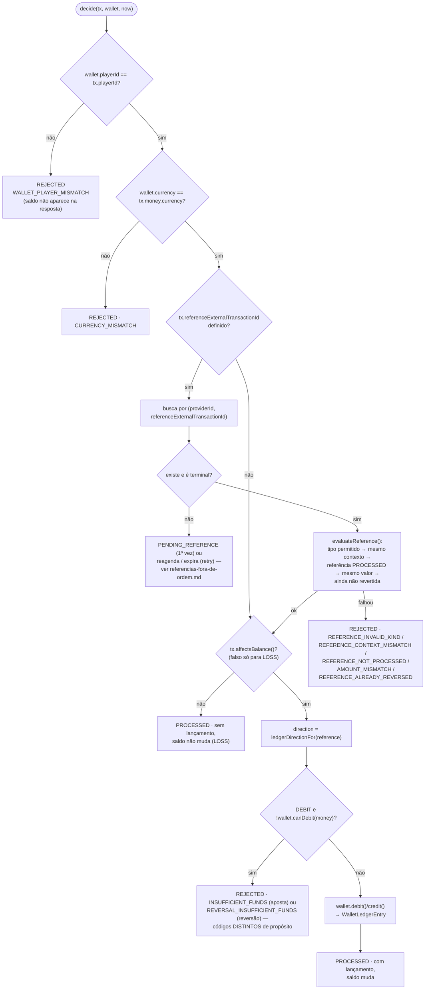

# Regras de liquidação (`WagerSettlement.decide`)

`src/modules/wagering/application/use-cases/wager-settlement.ts` — a decisão de negócio, sempre
chamada **sob o lock da wallet**. É compartilhada por quem processa a transação pela primeira vez
(HTTP ou SQS, via `ProcessWagerTransactionUseCase`) e por quem reprocessa uma pendência (o
scheduler, via `ResolvePendingReferenceUseCase`) — as regras são exatamente as mesmas nos dois
casos.

## Tabela de operações

| `kind` | Efeito no saldo | Ledger | Pode referenciar |
|---|---|---|---|
| `BET` | débito | 1 `DEBIT` | — |
| `WIN` | crédito | 1 `CREDIT` | `BET` (opcional, mesma rodada) |
| `LOSS` | nenhum | nenhuma | — |
| `REFUND` | crédito (reverte a `BET`) | 1 `CREDIT` | `BET` (obrigatório) |
| `ROLLBACK` | inverso da referência | 1 entrada invertida | `BET`, `WIN` ou `REFUND` (obrigatório) |

## Regras de referência (`evaluateReference`, domínio puro — `reference-policy.ts`)

Ordem de verificação, da mais estrutural pra mais circunstancial — a primeira que falhar decide
o `failureCode`:

1. **Tipo permitido**: `WIN`/`REFUND` só referenciam `BET`; `ROLLBACK` referencia `BET`, `WIN` ou
   `REFUND`. Fora disso → `REFERENCE_INVALID_KIND`.
2. **Mesmo contexto**: `providerId`, `playerId`, `walletId`, moeda e `roundId` da referência
   precisam bater com os da transação. → `REFERENCE_CONTEXT_MISMATCH`.
3. **Referência aplicada**: só pode referenciar uma transação `PROCESSED`. → `REFERENCE_NOT_PROCESSED`.
4. **Mesmo valor** (só para `REFUND`/`ROLLBACK`): reversão parcial está fora de escopo. → `AMOUNT_MISMATCH`.
5. **Ainda não revertida** (só para `REFUND`/`ROLLBACK`): uma referência não pode ser revertida
   duas vezes pelo mesmo tipo de operação. → `REFERENCE_ALREADY_REVERSED`.

## Por que `INSUFFICIENT_FUNDS` e `REVERSAL_INSUFFICIENT_FUNDS` são códigos diferentes

Uma aposta sem saldo (`BET`) e uma reversão que deixaria o saldo negativo (`ROLLBACK` de um
`WIN` já gasto) são **situações operacionalmente diferentes** — a primeira é o jogador perdendo
normalmente; a segunda é um sinal de que algo já consumiu o prêmio antes da reversão chegar, e
pode exigir investigação. Por isso `WagerTransaction.insufficientFundsFailureCode()` devolve um
código distinto conforme o `kind` da transação que está sendo rejeitada, e as duas permanecem
auditáveis (a transação é persistida como `REJECTED`, nunca descartada).

## Replay de pendência usa a mesma função

`ResolvePendingReferenceUseCase` (`resolve-pending-reference.use-case.ts`) chama o **mesmo**
`WagerSettlement.decide()` — a única diferença é o que acontece quando a referência continua
indisponível: na primeira tentativa vira `PENDING_REFERENCE`; num retry, vira um novo
reagendamento ou, se o TTL expirou, `REJECTED · REFERENCE_NOT_FOUND`. Ver
[referencias-fora-de-ordem.md](./referencias-fora-de-ordem.md).

## Arquivos

- `src/modules/wagering/application/use-cases/wager-settlement.ts`
- `src/modules/wagering/domain/reference-policy.ts`
- `src/modules/wagering/domain/entities/wager-transaction.ts` (`ledgerDirectionFor`,
  `insufficientFundsFailureCode`, `affectsBalance`, `isReversal`)
- `src/modules/wagering/error/failure-code.ts` — taxonomia completa de `failureCode`
